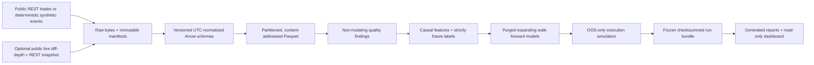

# Order Flow to Price Impact

A research-only, event-driven market-microstructure platform for asking:

> When do order-flow imbalance, liquidity, and limit-order-book conditions
> predict short-horizon price movement, and how much apparent value survives
> fees, latency, uncertain fills, adverse selection, and inventory risk?

The project is deliberately reproducibility-first. It keeps market-data evidence,
predictive diagnostics, execution assumptions, and simulated outcomes separate.
It has no authenticated exchange client, account connection, or order-entry path.

> **Evidence boundary:** `SYNTHETIC_SMOKE` output verifies software behavior only.
> It is not market, alpha, profitability, or investment evidence.

## Architecture



The normalized event contract retains exchange time, local receipt time when
captured, the conservative availability clock used by research, exact integer
ticks/lots, sequence identifiers, and a continuity epoch. Features, labels,
folds, open orders, and markouts cannot cross a known book gap.

## Quick start

Python 3.12 is required. The default acceptance path is deterministic and does
not need internet access:

```bash
make setup
make check
make reproduce-sample
make report
```

The frozen sample is written to `artifacts/runs/sample-smoke`; independently
rendered reports go to `artifacts/runs/sample-smoke-reports`. Both directories
are reproducible and intentionally ignored by Git.

To inspect the completed run:

```bash
make verify-run
make dashboard
```

The dashboard loads only checksum-verified artifacts. It does not download data,
fit models, rerun simulations, or place orders.

## Credential-free public sample

The bounded public path downloads BTCUSDT and ETHUSDT aggregate trades from a
fixed UTC interval, fetches `exchangeInfo` for exact tick and lot scales, keeps
the response bytes, and writes raw and normalized manifests:

```bash
make download-sample
.venv/bin/python -m microstructure.cli validate \
  --config configs/public_sample.toml
```

It uses Binance's public market-data-only REST base URL and requires no API key.
The adapter honors retryable status codes, `Retry-After`, and interrupted body
streams; paginates by trade ID to avoid losing tied timestamps; enforces a
response-byte ceiling; and imposes a small per-symbol row cap. Pages flow once
through disk-backed incremental validation into bounded Parquet batches. See
the official [Spot REST documentation](https://developers.binance.com/en/docs/products/spot/rest-api)
and [Spot WebSocket stream guide](https://developers.binance.com/en/docs/catalog/core-trading-spot-trading/api/ws-streams/~).

Historical public trade ingestion and live order-book collection are separate on
purpose. Public historical Spot depth is not assumed to exist. A book-based
empirical study begins only after a continuous local snapshot/delta epoch has
been captured and passed sequence checks.

Producing a public research bundle never scans for a "latest" input. Select the
immutable ingestion manifest explicitly by both path and digest:

```bash
make reproduce-public-sample \
  PUBLIC_INGESTION_MANIFEST=data/_ingestion_manifests/<manifest>.json \
  PUBLIC_INGESTION_MANIFEST_SHA256=<64-character-sha256>
make verify-public-run
make report-public
```

## Frozen multi-date trade study

The prospective M8 trade-only study uses the complete BTCUSDT and ETHUSDT
Binance Spot daily aggregate-trade archives for 2024-01-03 through 2024-01-06.
Acquisition is deliberately separate from research production:

```bash
# Networked, raw-only: authenticates ZIP/CHECKSUM/metadata evidence but never
# opens a CSV member or reads an economic field.
make download-m8

# Copy the manifest path and lowercase SHA-256 printed by download-m8.
# Production requires the exact clean committed source tree.
make reproduce-m8 \
  M8_RAW_MANIFEST=data/m8/_manifests/<manifest>.json \
  M8_RAW_MANIFEST_SHA256=<64-character-sha256>
make verify-m8-run \
  M8_RAW_MANIFEST=data/m8/_manifests/<manifest>.json \
  M8_RAW_MANIFEST_SHA256=<64-character-sha256>
make report-m8 \
  M8_RAW_MANIFEST=data/m8/_manifests/<manifest>.json \
  M8_RAW_MANIFEST_SHA256=<64-character-sha256>
```

The producer opens and validates only the train and validation members first.
It fits and calibrates the selected model and an independent historical prior
exactly once on development data, persists their canonical numeric preprocessing
and estimator states in each per-symbol lock, closes one aggregate lock, and
revalidates the exact protocol, config, Git/source identity, raw authority,
development manifest, fitted-state hashes, and child locks immediately before
every held-out member is opened. Held-out evaluation restores those states with
no fit, refit, recalibration, or update.
A declared-data failure becomes an immutable `INSUFFICIENT_DATA` bundle with no
replacement date or endpoint predictions. A successful bundle remains
trade-only: execution, P&L, capacity, significance, and cross-instrument pooling
are unauthorized by the protocol.

## Frozen live-L2 sessions

Each declared date is captured by one command that waits for the exact common
UTC barrier and starts both public market-data feeds under one authority. It
never authenticates or exposes an order-entry path:

```bash
make capture-m8-l2-session M8_L2_SESSION_DATE=2026-08-08
```

The other declared dates are 2026-08-09, 2026-08-10, and 2026-08-11. A missed,
disconnected, gapped, warning-bearing, or otherwise insufficient date is frozen
as such and is never replaced. Only checksum-verified `COMPLETE` bundles may be
consumed by later L2 research.

## Commands

| Command | Purpose |
| --- | --- |
| `make setup` | Create/synchronize the locked Python 3.12 environment |
| `make download-sample` | Download the bounded credential-free public trade sample |
| `make download-m8` | Acquire the frozen M8 raw authority without opening archive members |
| `make capture-m8-l2-session M8_L2_SESSION_DATE=YYYY-MM-DD` | Capture the frozen concurrent BTCUSDT/ETHUSDT L2 session for one declared date |
| `make validate-data` | Run offline, non-mutating validation on the synthetic fixture |
| `make validate-public-data` | Validate configured public normalized partitions incrementally |
| `make smoke` | Produce or verify the immutable synthetic vertical slice |
| `make test` | Run all unit and integration tests without network access |
| `make reproduce-sample` | Alias for the canonical smoke producer |
| `make reproduce-public-sample` | Produce a trade-only run from an explicit manifest path + SHA |
| `make reproduce-m8` | Produce M8 from an explicit raw manifest + SHA under a clean commit |
| `make verify-run` | Verify run structure and every protected checksum |
| `make verify-public-run` | Verify the explicit public run bundle |
| `make verify-m8-run` | Verify a complete or `INSUFFICIENT_DATA` M8 terminal bundle |
| `make report` | Render a fresh report set from the frozen bundle |
| `make report-m8` | Render a complete M8 bundle or expose its frozen failure report |
| `make dashboard` | Open the local read-only Streamlit research dashboard |
| `make check` | Run Ruff, strict mypy, pytest, and the smoke producer |

The equivalent CLI is available as `microstructure` after setup. Run
`microstructure --help` for the `ingest`, `acquire-m8`, `validate`, `reproduce`,
`reproduce-m8`, `verify-m8`, `report-m8`, generic `verify`/`report`, the frozen
`capture-m8-l2-session`, and exploratory research-only `collect-l2` commands.

## What is implemented

- Credential-free aggregate-trade ingestion with bounded retries, raw response
  preservation, symbol metadata, exact scaling, immutable manifests, and
  streaming partitioned Parquet writes. A verified public reader performs
  physical-order incremental DQ and a single upstream Parquet pass into a
  spill-capable DuckDB canonical sort; eager compatibility reads have a separate
  hard row limit.
- Optional public live diff-depth capture plus REST snapshot anchoring and pure
  `U/u` reconstruction with stale, overlap, gap, crossed-book, and invariant
  checks. Reconnection starts a new continuity epoch. The frozen L2 runner uses
  one absolute UTC barrier for both instruments, a byte-bounded receiver queue,
  OBSERVED-only continuity intervals, cross-symbol overlap gates, exhaustive
  artifact inventory, and atomic `COMPLETE`/`INSUFFICIENT_DATA` evidence.
- Typed quality findings for duplicates, ordering and clocks, invalid values,
  scale mismatches, abnormal spread, silence, gaps, and crossed books. Validation
  never repairs observations.
- Leakage-safe spread, L1/L5/L10 depth state, queue imbalance, microprice, OFI,
  signed flow, intensity, volatility, observable zero-quantity cancellation,
  causal lagged impact/recovery, regime, and stability features, with event-time
  and clock-time labels and explicit censoring.
- A common-fold model ladder: historical prior, unpenalized logistic regression,
  L2-regularized logistic grid, and shallow tree. Selection uses validation data;
  the final test is frozen. Calibration and fixed-block bootstrap diagnostics are
  serialized with their block count, status, and seed; the block scheme is not
  presented as a complete model of cross-instrument or overlapping-label
  dependence.
- OOS-only market/limit simulation with decision and order latency, maker/taker
  fees, adverse price rounding, top-depth caps, partial fills, a declared queue
  proxy, adverse selection, inventory limits, liquidation, turnover, and size
  sensitivity.
- Atomic run production. `_SUCCESS` is written last; every other file is covered
  by `checksums.sha256`. A completed target is read-only and reusable only after
  verification.
- Raw-only M8 acquisition with exact official CHECKSUM evidence, bounded ZIP
  central-directory inspection, a hard retained-evidence byte ledger, an exact
  content-addressed inventory, and an atomic self-contained bundle copy. The M8
  producer enforces development-only normalization and final selected/prior
  fitting before a durable analysis lock, restores transparent numeric states
  for prediction, and fails closed at every held-out member-open boundary.
- Generated technical report, two-page IC memo, held-out comparison table, and
  six-tab Streamlit dashboard, all downstream of frozen serialized artifacts.

## Run contents

Each completed run includes:

```text
run_manifest.json             # data interval, symbols, artifact map, assumptions
provenance.json               # config/input hashes, seed, runtime, Git commit/state
resolved_config.json
data/normalized/              # partitioned Parquet + immutable manifests
quality/summary.json
research/                     # full/evaluation frames and exact fold indices
models/                       # all predictions and selected held-out predictions
metrics/                      # predictive, execution, and sensitivity diagnostics
execution/                    # orders, fills, positions, replay state
reports/                      # code-generated report, memo, comparison table
dashboard/market_state.parquet
checksums.sha256
_SUCCESS
```

The semantic run key is derived from the configuration, immutable input identity,
Git commit, the exact tracked/non-ignored source-tree digest, and seed—not
generation timestamps. Reuse additionally requires the current source identity
to match; an older clean bundle cannot masquerade as evidence for changed code.

## Main findings and current evidence

As of 2026-08-08:

- The integrated offline suite passes 574 tests, Ruff, and strict mypy across 40
  source modules covering the
  data, reconstruction, timing, modeling, execution, reporting, dashboard, and
  pipeline boundaries.
- A fixed public sample for 2024-01-02 downloaded and normalized 10,000 real
  aggregate trades: 5,000 each for BTCUSDT and ETHUSDT. The configured cap was
  reached for both instruments, so both ranges are explicitly marked incomplete.
  The current validators reported zero errors and zero warnings on those rows.
- The generated trade-only report serializes per-symbol paired held-out
  model-minus-prior diagnostics without pooling instruments. Exact metrics live
  only in the checksum-verified run bundle; they are not manually copied into
  this file.
- The single-date, cap-truncated, validation-selected diagnostics do
  not authorize a statistical-significance, persistent-alpha, profitability,
  or capacity claim. The public bundle records execution and P&L as `NOT_RUN`;
  synthetic model/P&L values are never interpreted economically.
- The prospective M8 acquisition, lock-before-open producer, failure bundle,
  verifier, and report interfaces are implemented and tested offline. The eight
  official archives and their CHECKSUM/metadata evidence are now present in the
  verified raw-only authority
  `data/m8/_manifests/m8-acquisition.manifest-04d5c01f3810b6a300ec.json`
  (SHA-256 `04d5c01f3810b6a300ec0f9317052f254b2bec5d89bc0dfefd18cd71ad6582e6`).
  The raw-acquisition phase opened no CSV member. A subsequent clean-source
  attempt opened development training members only and stopped at its frozen DQ
  gate before selection, locks, or held-out access. Its source-tagged evidence
  is retained but not promoted because it exposed a raw/derived bundle-layout
  verifier defect. The corrected producer generates a fresh self-verified
  terminal under a new clean commit; that bundle, rather than prose here, is the
  authority for its final status.

This distinction is the main research conclusion so far: a functioning simulator
is not evidence that a market effect exists.

## Limitations and next milestone

Exchange timestamps are not colocated receipt times. Public trades cannot reveal
true queue priority, hidden liquidity, cancellations, or endogenous impact. The
limit-fill mechanism is therefore a scenario proxy, and reported sensitivity is
not deployable capacity. A short crypto interval cannot generalize across dates,
venues, or asset classes; overlapping horizons also reduce effective sample size
and make multiplicity control necessary.

The post-commit empirical sequence is to execute the frozen M8 multi-date trade
study from that explicit raw-only authority under a clean commit, measure peak
resident memory on the complete archives, and publish its complete or
`INSUFFICIENT_DATA` bundle.
Book-dependent claims remain a separate milestone requiring the already-frozen
prospective, simultaneous BTCUSDT/ETHUSDT local-L2 sessions and continuous valid
epochs. No trade-only result can substitute for that evidence.

See [the research protocol](docs/RESEARCH_PROTOCOL.md), [data contract](docs/DATA_CONTRACT.md),
[project plan](docs/PROJECT_PLAN.md), [decision log](docs/DECISION_LOG.md), and
[methodology limitations](reports/methodology_limitations.md) for the exact
contracts and promotion rules.

## Portfolio material

The source-controlled report files contain no manually pasted performance
numbers. Run-specific documents are generated from verified bundles. Supporting
communication artifacts are in `portfolio/`: an interview narrative, three
resume-bullet variants, and a ten-minute presentation outline.

Licensed under the MIT License. This repository is for research and simulation,
not investment advice or live trading.
