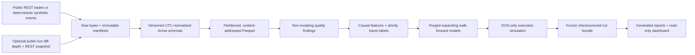

# Order Flow to Price Impact

A research-only, event-driven market-microstructure platform for asking:

> When do order-flow imbalance, liquidity, and limit-order-book conditions
> predict short-horizon price movement, and how much apparent value survives
> fees, latency, uncertain fills, adverse selection, and inventory risk?

The project is deliberately reproducibility-first. It keeps market-data evidence,
predictive diagnostics, execution assumptions, and simulated outcomes separate.
It has no authenticated exchange client, account connection, or order-entry path.

> **Evidence boundary:** `SYNTHETIC_SMOKE` output verifies software behavior only.
> It is not market, alpha, profitability, or investment evidence.

## Architecture



The normalized event contract retains exchange time, local receipt time when
captured, the conservative availability clock used by research, exact integer
ticks/lots, sequence identifiers, and a continuity epoch. Features, labels,
folds, open orders, and markouts cannot cross a known book gap.

## Quick start

Python 3.12 is required. The default acceptance path is deterministic and does
not need internet access:

```bash
make setup
make check
make reproduce-sample
make report
```

The frozen sample is written to `artifacts/runs/sample-smoke`; independently
rendered reports go to `artifacts/runs/sample-smoke-reports`. Both directories
are reproducible and intentionally ignored by Git.

To inspect the completed run:

```bash
make verify-run
make dashboard
```

The dashboard loads only checksum-verified artifacts. It does not download data,
fit models, rerun simulations, or place orders.

## Credential-free public sample

The bounded public path downloads BTCUSDT and ETHUSDT aggregate trades from a
fixed UTC interval, fetches `exchangeInfo` for exact tick and lot scales, keeps
the response bytes, and writes raw and normalized manifests:

```bash
make download-sample
.venv/bin/python -m microstructure.cli validate \
  --config configs/public_sample.toml
```

It uses Binance's public market-data-only REST base URL and requires no API key.
The adapter honors retryable status codes and `Retry-After`, paginates by trade
ID to avoid losing tied timestamps, and imposes a small per-symbol row cap. See
the official [Spot REST documentation](https://developers.binance.com/en/docs/products/spot/rest-api)
and [Spot WebSocket stream guide](https://developers.binance.com/en/docs/catalog/core-trading-spot-trading/api/ws-streams/~).

Historical public trade ingestion and live order-book collection are separate on
purpose. Public historical Spot depth is not assumed to exist. A book-based
empirical study begins only after a continuous local snapshot/delta epoch has
been captured and passed sequence checks.

## Commands

| Command | Purpose |
| --- | --- |
| `make setup` | Create/synchronize the locked Python 3.12 environment |
| `make download-sample` | Download the bounded credential-free public trade sample |
| `make validate-data` | Run offline, non-mutating validation on the synthetic fixture |
| `make smoke` | Produce or verify the immutable synthetic vertical slice |
| `make test` | Run all unit and integration tests without network access |
| `make reproduce-sample` | Alias for the canonical smoke producer |
| `make verify-run` | Verify run structure and every protected checksum |
| `make report` | Render a fresh report set from the frozen bundle |
| `make dashboard` | Open the local read-only Streamlit research dashboard |
| `make check` | Run Ruff, strict mypy, pytest, and the smoke producer |

The equivalent CLI is available as `microstructure` after setup. Run
`microstructure --help` for the `ingest`, `validate`, `reproduce`, `verify`,
`report`, and research-only `collect-l2` commands.

## What is implemented

- Credential-free aggregate-trade ingestion with bounded retries, raw response
  preservation, symbol metadata, exact scaling, immutable manifests, and
  streaming partitioned Parquet writes.
- Optional public live diff-depth capture plus REST snapshot anchoring and pure
  `U/u` reconstruction with stale, overlap, gap, crossed-book, and invariant
  checks. Reconnection starts a new continuity epoch.
- Typed quality findings for duplicates, ordering and clocks, invalid values,
  scale mismatches, abnormal spread, silence, gaps, and crossed books. Validation
  never repairs observations.
- Leakage-safe spread, L1/L5/L10 depth state, queue imbalance, microprice, OFI,
  signed flow, intensity, volatility, impact, recovery, regime, and stability
  research APIs, with event-time and clock-time labels and explicit censoring.
- A common-fold model ladder: historical prior, unpenalized logistic regression,
  L2-regularized logistic grid, and shallow tree. Selection uses validation data;
  the final test is frozen. Calibration and fixed-block bootstrap diagnostics are
  serialized with their block count, status, and seed; the block scheme is not
  presented as a complete model of cross-instrument or overlapping-label
  dependence.
- OOS-only market/limit simulation with decision and order latency, maker/taker
  fees, adverse price rounding, top-depth caps, partial fills, a declared queue
  proxy, adverse selection, inventory limits, liquidation, turnover, and size
  sensitivity.
- Atomic run production. `_SUCCESS` is written last; every other file is covered
  by `checksums.sha256`. A completed target is read-only and reusable only after
  verification.
- Generated technical report, two-page IC memo, held-out comparison table, and
  six-tab Streamlit dashboard, all downstream of frozen serialized artifacts.

## Run contents

Each completed run includes:

```text
run_manifest.json             # data interval, symbols, artifact map, assumptions
provenance.json               # config/input hashes, seed, runtime, Git commit/state
resolved_config.json
data/normalized/              # partitioned Parquet + immutable manifests
quality/summary.json
research/                     # full/evaluation frames and exact fold indices
models/                       # all predictions and selected held-out predictions
metrics/                      # predictive, execution, and sensitivity diagnostics
execution/                    # orders, fills, positions, replay state
reports/                      # code-generated report, memo, comparison table
dashboard/market_state.parquet
checksums.sha256
_SUCCESS
```

The semantic run key is derived from the configuration, immutable input identity,
Git state, and seed—not generation timestamps. Repeating a completed run does
not mutate it.

## Main findings and current evidence

As of 2026-08-07:

- The integrated offline suite passes 90 tests, Ruff, and strict mypy across the
  data, reconstruction, timing, modeling, execution, reporting, dashboard, and
  pipeline boundaries.
- A fixed public sample for 2024-01-02 downloaded and normalized 10,000 real
  aggregate trades: 5,000 each for BTCUSDT and ETHUSDT. The configured cap was
  reached for both instruments, so both ranges are explicitly marked incomplete.
  The current validators reported zero errors and zero warnings on those rows.
- No empirical price-prediction, statistical-significance, profitability, or
  capacity finding is supported. The public sample contains trades only and is
  intentionally too narrow and capped for promotion under the research protocol.
  Synthetic model and P&L values are never interpreted economically.

This distinction is the main research conclusion so far: a functioning simulator
is not evidence that a market effect exists.

## Limitations and next milestone

Exchange timestamps are not colocated receipt times. Public trades cannot reveal
true queue priority, hidden liquidity, cancellations, or endogenous impact. The
limit-fill mechanism is therefore a scenario proxy, and reported sensitivity is
not deployable capacity. A short crypto interval cannot generalize across dates,
venues, or asset classes; overlapping horizons also reduce effective sample size
and make multiplicity control necessary.

The next empirical milestone is a predeclared multi-date study with both default
instruments, contiguous local L2 epochs for book claims, adjacent untouched test
periods, reference-only regime thresholds, block uncertainty, failed-hypothesis
disclosure, and robustness across fees, latency, fill, and liquidation choices.

See [the research protocol](docs/RESEARCH_PROTOCOL.md), [data contract](docs/DATA_CONTRACT.md),
[project plan](docs/PROJECT_PLAN.md), [decision log](docs/DECISION_LOG.md), and
[methodology limitations](reports/methodology_limitations.md) for the exact
contracts and promotion rules.

## Portfolio material

The source-controlled report files contain no manually pasted performance
numbers. Run-specific documents are generated from verified bundles. Supporting
communication artifacts are in `portfolio/`: an interview narrative, three
resume-bullet variants, and a ten-minute presentation outline.

Licensed under the MIT License. This repository is for research and simulation,
not investment advice or live trading.
